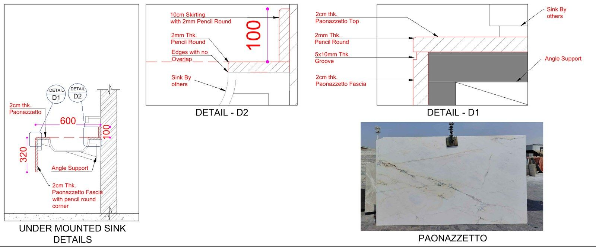

**رسومات الرخام التنفيذية هي مخططات تفصيلية تحوّل تصميم الرخام إلى معلومات قابلة للقص والتصنيع والتركيب:** مقاس كل قطعة، موقعها، اتجاه عروقها، فواصلها وتفاصيل التقاءها بالعناصر المحيطة. يحتاجها المقاول ومصنع الرخام والاستشاري لتوحيد المرجع قبل بدء العمل، بدل ترك القرارات المهمة لاجتهاد الورشة أو فريق الموقع. وفي مشاريع الإمارات، ترتبط متطلبات تقديمها واعتمادها بالعقد والمواصفات وإجراءات المشروع؛ فلا يوجد نموذج واحد يناسب كل الأعمال.

سواء كنت تنفّذ مدخل فيلا في دبي، أو تكسية حمامات في أبوظبي، أو أعمال فيت أوت في الشارقة، فالسؤال العملي ليس كيف سيبدو الرخام فقط، بل كيف سيُركّب وفق الأبعاد الفعلية والتفاصيل المعتمدة. يشرح هذا الدليل مكونات الحزمة، وتسلسل إعدادها، والنقاط التي تستحق المراجعة قبل إصدار أمر القص. وللتعرّف إلى نطاق العمل، يمكنك زيارة [خدمة رسومات الرخام التنفيذية](/ar/marble.html) أو [الصفحة الرئيسية العربية لـ D3DDD](/ar/).

## ما الفرق بين التصميم ورسومات الرخام التنفيذية؟

يبين مخطط التصميم الفكرة العامة: نوع الرخام، توزيع المساحات، الشكل المرغوب ونمط الأرضيات أو الجدران. أما المخطط التنفيذي فيوضح كيف تتحول هذه الفكرة إلى قطع محددة، وأين تبدأ شبكة التوزيع، وكيف تعالج الزوايا والفتحات والعتبات. قد يبدو التصميم متكاملًا بصريًا، لكنه لا يحدد دائمًا سماكة طبقات التركيب أو علاقة الكسوة بفتحة الباب.

خذ مثالًا بسيطًا: يطلب المصمم أرضية متناظرة حول محور المدخل. على الرسام أن يراجع عرض المساحة بعد التشطيبات، ويحدد نقطة البداية، ويتحقق من عرض القطع الطرفية وعلاقة النمط بالعتبات. بهذا تصبح النية التصميمية قابلة للمراجعة والتنفيذ. ويمكن الرجوع إلى [الدليل الإنجليزي لرسومات الرخام](/blog/what-are-marble-shop-drawings/) إذا كان فريق المشروع يعمل بلغتين.

## ماذا تتضمن حزمة رسومات الرخام؟

### مخططات توزيع الأرضيات ونقاط التوقيع

توضح المخططات حدود المناطق، وأبعاد القطع، واتجاه التركيب، والمحاور المرجعية، ومناسيب التشطيب النهائي عند الحاجة. ويجب توضيح عرض الفواصل ومواقع فواصل الحركة بحسب التصميم والمواصفات، لا اختيارها عشوائيًا داخل الرسم. كما تُراجع علاقة الأرضية بالوزرات والأبواب والمصاعد ومصارف المياه وأي تطعيمات معدنية.

- ترقيم واضح للمناطق والقطع وربطها بالجداول.
- تحديد نقطة بداية التوزيع وأبعاد الربط بالمحاور.
- بيان الحدود بين أنواع الرخام أو التشطيبات المختلفة.
- إظهار الانتقالات عند العتبات والمداخل والمناطق الرطبة.

### واجهات التكسية والفتحات

تبين واجهات الجدران تقسيم الألواح رأسيًا وأفقيًا، ومنسوب كل صف، ومواقع الفتحات والنيش والمفاتيح. ويُراجع توزيع العروق قبل القص عندما يكون التطابق البصري مطلوبًا، خصوصًا في الجدران البارزة. أما فتحات الخلاطات والمغاسل فتُنسّق مع المنتجات والمخططات المعتمدة، لا مع أبعاد تقديرية من صورة مرجعية.

الصورة أعلاه مثال من أعمال D3DDD يوضح العلاقة بين مخطط الحمام وواجهات التكسية وتفاصيل الزوايا. الاطلاع على الرسومات الفعلية يساعد فريق المشروع على الاتفاق على مستوى التفاصيل المطلوب، ويمكن مشاهدة أمثلة إضافية ضمن [مشاريع الرخام والتفاصيل التنفيذية](/projects/).

### المقاطع والحواف وطرق التثبيت

توضح المقاطع سماكة الحجر وطبقات التركيب وشكل الحافة والتقاء القطع بالدعامات أو العناصر المجاورة. وتشمل التفاصيل، بحسب النطاق، الزوايا المشطوفة أو الميتَر، وحواف أسطح المغاسل، ومجاري التقطير. ويُحدَّد نظام تثبيت الكسوة وفق مواصفات المشروع وتصميم الجهة المختصة؛ فالرسومات لا تغني عن التحقق الهندسي المطلوب للمراسي أو الأحمال.

<figure class="hero-fig"><figcaption class="img-credit">مثال لتفاصيل حواف سطح مغسلة وتقاطعه مع الحوض والدعامة من أعمال D3DDD.</figcaption></figure>

### جداول القطع ومعلومات الخامة

يحتاج المصنع إلى جدول يربط رقم القطعة بمقاسها وسماكتها وتشطيبها وموقعها. وتُسجّل الحواف الخاصة والفتحات واتجاه العروق حتى لا تُقص القطعة الصحيحة بوجه أو اتجاه خاطئ. أما توزيع القطع على الألواح الخام فيتطلب معرفة المقاسات الفعلية والعيوب والعروق ومراعاة سماحية أداة القص.

ولفهم الفرق بين حصر القطع وتخطيط الألواح، راجع [توزيع القطع على الألواح وقوائم القص في مشاريع الخليج](/blog/slab-nesting-cutting-lists-gulf/). لا ينبغي اعتبار مساحة الأرضية الصافية مساوية تلقائيًا لكمية الشراء؛ فالنمط والمقاسات والانتقاء البصري تؤثر جميعها في الاحتياج الفعلي.

## لماذا تحتاجها مشاريع دبي وأبوظبي والشارقة؟

### تقليل إعادة التصنيع قبل أن تصبح مكلفة

يمكن تعديل خط أو بعد في ملف الرسم، لكن تعديل قطعة رخام مقصوصة قد يستدعي استبدالها. وقد يصعب إيجاد بديل مطابق للون والعروق من دفعة أخرى. لذلك تساعد مراجعة الأبعاد والفتحات والحواف مسبقًا على اكتشاف الأخطاء في مرحلة أقل كلفة، من دون أن تعني إلغاء جميع مخاطر التنفيذ.

### تنسيق التشطيبات بين المقاولين

تلتقي أعمال الرخام مع النجارة والزجاج والألمنيوم والأعمال الكهروميكانيكية. في أعمال الفيت أوت، قد تتغير مواقع المخارج أو سماكات التشطيبات أثناء التنسيق. وجود رسم مضبوط يوضح مرجع المناسيب وحدود كل نطاق، ويساعد على كشف التعارض قبل وصول فريق التركيب. وهذا مهم في المشاريع المتسارعة مهما كانت الإمارة التي يقع فيها الموقع.

### مرجع واضح للمراجعة والتسليم

يحتاج الاستشاري إلى مقارنة المقترح بالتصميم والمواصفات، ويحتاج المقاول إلى نسخة سارية يمكن توزيعها على المصنع والموقع. تسجل الحزمة الجيدة أرقام اللوحات والمراجعات والملاحظات والحالة، بحيث لا يعمل فريق على إصدار قديم. وتتحدد صلاحية التصنيع أو التركيب وفق حالة الاعتماد وإجراءات المشروع، لا بمجرد إرسال ملف بالبريد.

وتختلف أولويات المشروع حسب الاستخدام: قد يركز مدخل فيلا في دبي على تماثل النمط، بينما تتطلب حمامات مشروع في أبوظبي تنسيقًا دقيقًا للمصارف، وتحتاج مساحة تجارية في الشارقة إلى ضبط الانتقالات مع واجهات المحلات. هذه أمثلة تنسيقية، وليست اشتراطات خاصة بجهة محلية. المرجع دائمًا هو العقد والمواصفات والمخططات المعتمدة للموقع نفسه.

## كيف تُعد الرسومات وتُراجع خطوة بخطوة؟

1. **استلام المدخلات:** المخططات المعمارية والداخلية، مواصفات الرخام، الجداول وأحدث تعليقات الاستشاري، مع تحديد المناطق المشمولة والمخرجات المطلوبة.
2. **مراجعة الموقع:** تأكيد مسؤولية الرفع الموقعي وتاريخ القياسات، والتحقق من المناسيب والفتحات واستقامة الجدران قبل تثبيت أبعاد التصنيع.
3. **إعداد التوزيع والتفاصيل:** رسم الأرضيات والواجهات والمقاطع، وتنسيق التقاء الرخام مع التخصصات الأخرى وتحديد المعلومات الناقصة.
4. **التقديم والمراجعة:** إصدار ملفات واضحة، عادة بصيغتي PDF وDWG بحسب الاتفاق، وتسجيل الملاحظات والرد عليها في المراجعة التالية.
5. **إصدار معلومات التصنيع:** ربط القطع بقوائم القص بعد استكمال الموافقات والتحقق من المقاسات والخامة المتاحة وفق إجراءات المشروع.
6. **ضبط النسخ في التنفيذ:** التأكد من وصول المراجعة السارية إلى الورشة والموقع، وتوثيق التغييرات بدل اعتماد تعديلات شفهية غير مسجلة.

إذا ظهر تعارض بين القياس والتصميم، يجب إبرازه وطلب التوضيح قبل استكمال الجزء المتأثر. لا يصح إخفاء الفرق بتغيير الفواصل أو تصغير قطع ظاهرة من دون تنسيق. وللمراجعة المنظمة، استخدم [قائمة التحقق العملية لرسومات الرخام في الإمارات](/blog/marble-shop-drawings-checklist-uae/) كنقطة بداية، ثم أضف متطلبات الاستشاري الخاصة.

## ما الذي ينبغي تجهيزه قبل طلب عرض سعر؟

أرسل أحدث إصدار من ملفات التصميم مع قائمة المناطق المطلوبة ونوع الرخام وسماكته وتشطيبه. وضّح إن كان العمل يشمل الأرضيات فقط، أم التكسية والأسطح والدرج أيضًا. ومن المفيد تحديد الحاجة إلى قوائم القص وحصر الكميات وعدد دورات المراجعة المتوقعة، لأن عبارة «رسومات رخام كاملة» قد تعني نطاقات مختلفة لدى الأطراف.

أرفق القياسات المتاحة، وحدد ما إذا كانت معتمدة للتصنيع أو مبدئية للتنسيق. وإذا كان اختيار الألواح لم يُحسم، فاذكر ذلك حتى تُفصل مرحلة التوزيع العام عن مرحلة مطابقة العروق. تساعد هذه المعلومات على تقديم نطاق وسعر وموعد واقعيين، بدل وعود لا تستند إلى حجم العمل الفعلي.

### قائمة مراجعة سريعة قبل أمر القص

- هل تطابق أرقام المراجعات أحدث الرسومات والتعليقات؟
- هل جرى التحقق من الأبعاد على الطبيعة وتوثيق مصدرها؟
- هل تتوافق فتحات الأحواض والخلاطات مع المنتجات المعتمدة؟
- هل ترقيم القطع واحد في المخططات والجداول وقوائم القص؟
- هل اتجاه العروق والتشطيب والحواف واضح لكل قطعة؟
- هل حُسمت حالة اعتماد الرسم وأي ملاحظات مؤثرة في التصنيع؟

هذه القائمة لا تحل محل إجراءات الجودة في المشروع، لكنها تقلل احتمال تجاوز نقطة أساسية. وللتوسع في علاقة التوزيع الأفقي بالواجهات، اقرأ [دليل رسومات أرضيات الرخام وتكسية الجدران](/blog/marble-flooring-wall-cladding-shop-drawings/).

## أخطاء شائعة يمكن تجنبها في التقديم الأول

من الأخطاء المتكررة خلط مقاس القطعة النهائي بمقاس الفتحة الإنشائية، أو نسخ توزيع متكرر إلى غرف تختلف أبعادها الفعلية. كذلك قد تُذكر سماكة الحجر في الملاحظات العامة بينما يظهر مقطع بسماكة مختلفة. الحل العملي هو مراجعة التقاطعات بين المخطط والواجهة والمقطع والجدول، وليس مراجعة كل لوحة بمعزل عن البقية.

ومن المهم أيضًا عدم استخدام صورة ألواح تقريبية لاعتماد تطابق العروق النهائي. إذا كان التسلسل البصري جزءًا من التصميم، فنسّق مراجعة صور الألواح المختارة وترقيمها قبل إصدار تفاصيل القص. وعند تغيير خامة أو سماكة أو منتج صحي، راجع القطع المتأثرة وسجل سبب التعديل؛ فقد يمتد أثر قرار صغير إلى الحواف والدعامات والفتحات المجاورة.

## أسئلة شائعة عن رسومات الرخام التنفيذية

### هل الرسومات التنفيذية مطلوبة لكل مشروع في الإمارات؟

تعتمد الحاجة ومتطلبات الاعتماد على العقد وحجم العمل وإجراءات الاستشاري. وفي المشاريع التي تتطلب تقديمات فنية، تُراجع الرسومات عادة قبل التصنيع. حتى في الأعمال الصغيرة، يساعد توثيق المقاسات والتفاصيل على تقليل سوء الفهم بين المالك والمقاول والمصنع.

### هل يمكن البدء بالقص اعتمادًا على مخططات التصميم فقط؟

لا يُنصح بذلك عندما تنقص مقاسات القطع أو تفاصيل الفتحات والحواف. يجب استكمال معلومات التصنيع والتحقق من قياسات الموقع وحالة الاعتماد المطلوبة. وضوح الشكل العام لا يعني أن الملف يحتوي على كل ما تحتاجه الورشة للقص.

### ما الفرق بين الرسومات التنفيذية وقائمة القص؟

الرسومات التنفيذية توضح التوزيع والتفاصيل والعلاقات مع الموقع، بينما تسرد قائمة القص القطع وأبعادها ومعلومات تصنيعها. تكمل الوثيقتان بعضهما، ويجب أن تعتمدا على الترقيم والمراجعة نفسيهما حتى لا تصل تعليمات متناقضة إلى المصنع.

### هل يمكن إعداد الرسومات عن بُعد لمشروع في دبي أو أبوظبي؟

نعم، عند توفر ملفات التصميم والمواصفات وقياسات موقع موثوقة ومسار واضح للمراجعة. الإعداد عن بُعد لا يلغي مسؤولية التحقق الموقعي؛ ويجب الاتفاق مسبقًا على من يرفع القياسات ومن يعتمدها قبل إصدار معلومات التصنيع.

### كم يستغرق إعداد الرسومات وما تكلفتها؟

تختلف المدة والتكلفة بحسب عدد المناطق وتعقيد النمط والتفاصيل وجودة المدخلات ونطاق قوائم القص والمراجعات. الأفضل إرسال الملفات لتحديد عرض خاص بالمشروع، مع توثيق المخرجات والموعد وآلية التعامل مع أي تغييرات لاحقة في التصميم.

### هل الرسومات تضمن اعتماد الاستشاري أو تمنع الهدر بالكامل؟

لا. تساعد الرسومات المنسقة على تقديم معلومات أوضح وتقليل الأخطاء، لكن الاعتماد يتبع مراجعة الاستشاري ومتطلبات المشروع. كما يعتمد الهدر على جودة الألواح وتوزيع العروق والقص والتنفيذ. لا تُعد الرسومات وعدًا بنسبة توفير محددة أو اعتماد مضمون.

## ناقش نطاق مشروعك مع D3DDD

يعد D3DDD رسومات الرخام والحجر وتفاصيل التصنيع وقوائم القص للمقاولين والمصنّعين وفرق التصميم. يمكنك البدء بمراجعة [الخدمة بالعربية](/ar/marble.html) والأمثلة المنشورة في [معرض المشاريع](/projects/)، ثم إرسال نطاقك عبر [نموذج التواصل](/ar/contact.html).

أرفق المخططات المتاحة، وحدد الإمارة ومناطق العمل والموعد المستهدف، وسنراجع المطلوب لتوضيح المخرجات والتكلفة والبرنامج قبل البدء. الهدف هو أن ينتقل فريقك من تصور التصميم إلى مرجع واضح للورشة والموقع، مع بقاء قرارات الاعتماد والتثبيت والقياسات ضمن مسؤولياتها المتفق عليها.
