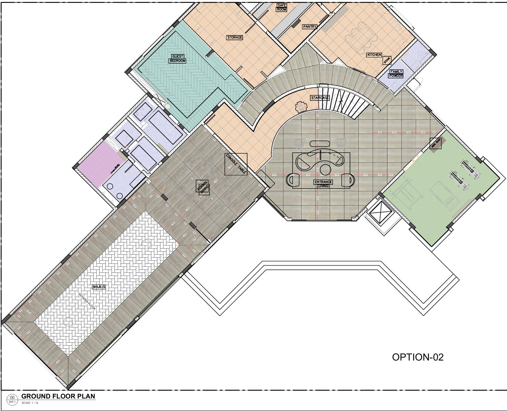
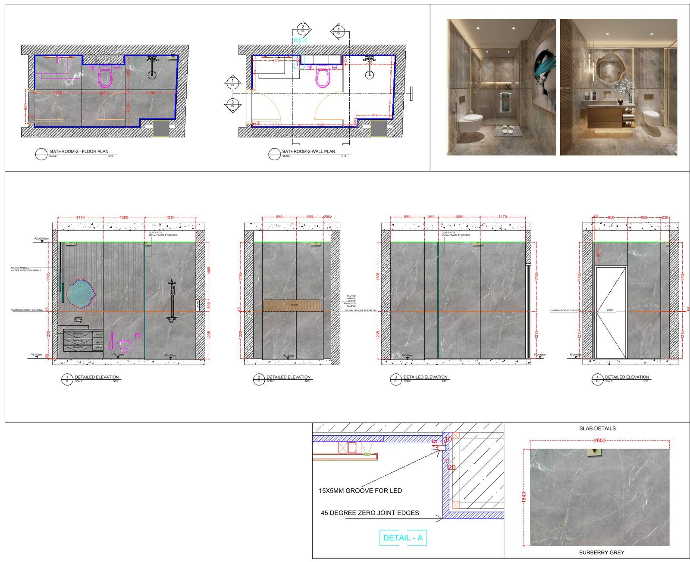

**Short answer:** marble flooring and wall cladding shop drawings are prepared by taking the approved design drawings, checking them against site dimensions, fixing a setting-out point, laying out every slab or tile with its joints, numbering each piece, and adding sections, edge and fixing details plus a piece schedule. The finished set goes to the consultant for approval before any stone is cut.

This guide walks through that process step by step for floors and walls on UAE projects. If you are new to the topic, start with [What Are Marble Shop Drawings and Why Are They Necessary?](https://d3ddd.com/blog/what-are-marble-shop-drawings/).

## Step 1: Collect the Right Inputs

Before drawing anything, gather:

1. The approved architectural or interior design drawings, ideally as DWG files
2. The finishes schedule and stone specification: stone type, thickness and surface finish
3. Site measurements, or confirmation that the design dimensions match what is built
4. Reflected ceiling, MEP and joinery drawings for anything that meets the stone
5. Consultant comments and any project-specific submission requirements

Missing inputs are the most common reason shop drawings get revised later, so it is worth asking for them up front.

## Step 2: Check the Drawings Against Site Conditions

Walls are rarely perfectly square and floors are rarely perfectly level. Compare the design dimensions with site measurements, note any differences, and decide with the contractor how they will be absorbed (for example, in a border, a skirting line or a cut row placed where it is least visible). Stone has to fit what is actually built, not what was drawn at concept stage.

## Step 3: Fix the Setting-Out Point

The setting-out point is where the pattern starts. For floors it is usually a room centre line, the main entrance, or a feature such as a medallion. For walls it is often a centre line on a feature wall, a door or window edge, or the finished floor level.

A good setting-out point:

- Keeps cut pieces at the edges and away from the main view
- Lines joints up with doors, openings and fixtures where possible
- Is easy for the installation team to mark on site

## Step 4: Draw the Marble Flooring Layout

The **marble floor layout** is a plan showing every piece. It typically includes:

- Size, orientation and position of each slab or tile
- Joint widths and the joint pattern (straight, staggered, herringbone and so on)
- Borders, inlays, medallions and transitions between materials
- Movement and expansion joint locations, as specified
- Thresholds and level changes at doors and wet areas
- Floor drains and falls in bathrooms, where they affect the stone

Each piece gets a reference number that ties back to the piece schedule.

*A villa ground floor flooring layout with material zoning and slab set-out. See the full [villa marble flooring layout project](https://d3ddd.com/projects/villa-ground-floor-marble-flooring-layout/).*

## Step 5: Draw the Wall Cladding Elevations

For **wall cladding shop drawings**, each wall is drawn as an elevation showing:

- Every cladding panel with its size and joint lines
- Openings for doors, windows, niches, sockets, switches and fittings
- Where the cladding starts and stops (finished floor level, ceiling line, skirting)
- Corner treatment: mitred, butt-jointed or with a trim
- Panel numbers that match the floor layout and piece schedule

Where vein direction or book matching matters, the elevations should show how panels are arranged so the pattern reads correctly across the wall.

*Bathroom wall and floor cladding drawn as coordinated layouts and elevations. See the [luxury bathroom marble cladding project](https://d3ddd.com/projects/luxury-bathroom-marble-cladding-shop-drawings/).*

## Step 6: Plan the Joint Layout

A **joint layout drawing** is often part of the plan and elevation set. It should make clear:

- The joint width the specification calls for
- How floor joints line up with wall joints at the base of the wall
- Where movement joints go and how they are finished
- How joints align across adjacent rooms and doorways

Lining floor and wall joints up looks better and is easier to install, so it is worth resolving on the drawing rather than leaving it to site.

## Step 7: Add Sections and Fixing Details

Plans and elevations show *where*; sections show *how*. Typical **stone cladding details** include:

- Floor build-up from slab to finished stone level
- Wall cladding sections showing the fixing method (adhesive fixing or mechanical anchors, as specified by the project)
- Edge profiles at steps, niches and exposed edges
- Interfaces with skirting, glass, joinery, metal trims and sanitary fittings
- Details at external corners, internal corners and openings

The fixing method should follow the project specification and the fixing system supplier's guidance, not a generic assumption.

## Step 8: Prepare the Piece Schedule and Cutting List

Every numbered piece goes into a schedule with its dimensions, thickness, finish and location. This becomes the basis for the cutting list the workshop follows and for the stone quantities. Good schedules help with planning slab use; we cover that in [Slab Nesting and Cutting Lists: How Gulf Stone Yards Cut Waste](https://d3ddd.com/blog/slab-nesting-cutting-lists-gulf/).

## Step 9: Check, Issue and Revise

Before submission, check that:

- Plans, elevations and schedules use the same piece numbers
- Dimensions add up and match site measurements
- Every opening and fixture is shown
- Title, revision and drawing numbers follow the project's format

Issue the set as PDF (and DWG if requested) for consultant review. Comments come back, the drawings are revised, and only the approved revision goes to fabrication. For a fabricator-focused checklist, see [Marble Shop Drawings in the UAE: A Practical Checklist for Fabricators](https://d3ddd.com/blog/marble-shop-drawings-checklist-uae/).

## Common Mistakes to Avoid

- Starting the layout without site measurements
- Placing small cut pieces at doorways or in the main line of sight
- Floor and wall joints that don't line up at the base of the wall
- Missing sockets, switches or drains on cladding elevations
- Piece numbers that differ between the layout and the schedule
- Fixing details that don't match the specified system

## Frequently Asked Questions

### What should marble flooring shop drawings include?

A floor layout with every piece sized, positioned and numbered, the setting-out point, joint widths and pattern, borders and inlays, movement joints, thresholds, sections showing the floor build-up, and a piece schedule.

### What is the difference between flooring and wall cladding shop drawings?

Flooring shop drawings are mainly plans showing the layout on the floor. Wall cladding shop drawings are mainly elevations showing each panel on the wall, with more emphasis on openings, corners and fixing details. On most projects they are prepared together so joints and materials line up.

### What software is used to prepare marble shop drawings?

AutoCAD is the most common choice, and drawings are usually issued as PDF and DWG. 3D models are sometimes used to check complex areas or to show the finished look before cutting.

### Why does the setting-out point matter?

It decides where full pieces and cut pieces fall. A well-chosen setting-out point keeps cuts at the edges, lines joints up with doors and features, and makes installation easier.

### Do marble cladding shop drawings need consultant approval in the UAE?

On most consultant-supervised projects in Dubai and the UAE, shop drawings are submitted for review and approval before fabrication. The exact requirement depends on the project contract and the consultant.

### How much do marble flooring and cladding shop drawings cost?

It depends on the size and complexity of the scope. A D3DDD shop drawing pack starts at **AED 1,200**, with 50% paid upfront. Larger scopes are quoted after reviewing the drawings.

## Get Marble Flooring and Cladding Shop Drawings from D3DDD

D3DDD (Dubai 3D Design & Draft) prepares marble flooring layouts, wall cladding elevations, stone details, cutting lists and BOQs for contractors, fabricators, designers and homeowners across the UAE. We also offer [architectural estimation](https://d3ddd.com/services/architectural-estimation/) and [3D rendering and visualization](https://d3ddd.com/services/3d-rendering-modeling-visualization/).

Learn more on our [Marble Shop Drawings service page](https://d3ddd.com/marble.html).

**Ready to start? [Request a quote for your marble shop drawings](https://d3ddd.com/contact.html).** Send your design drawings and scope, and we'll come back with a price and timeline. Shop drawing packs start at AED 1,200, with 50% upfront.

You can also see our work on Instagram at [@dubai3ddd](https://www.instagram.com/dubai3ddd/).
