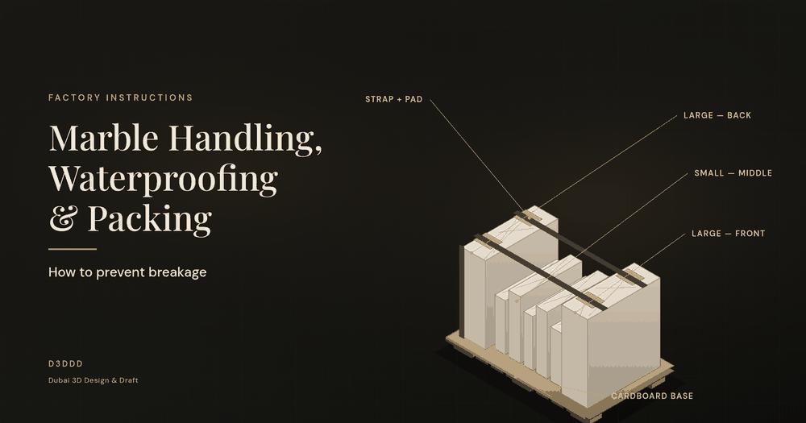
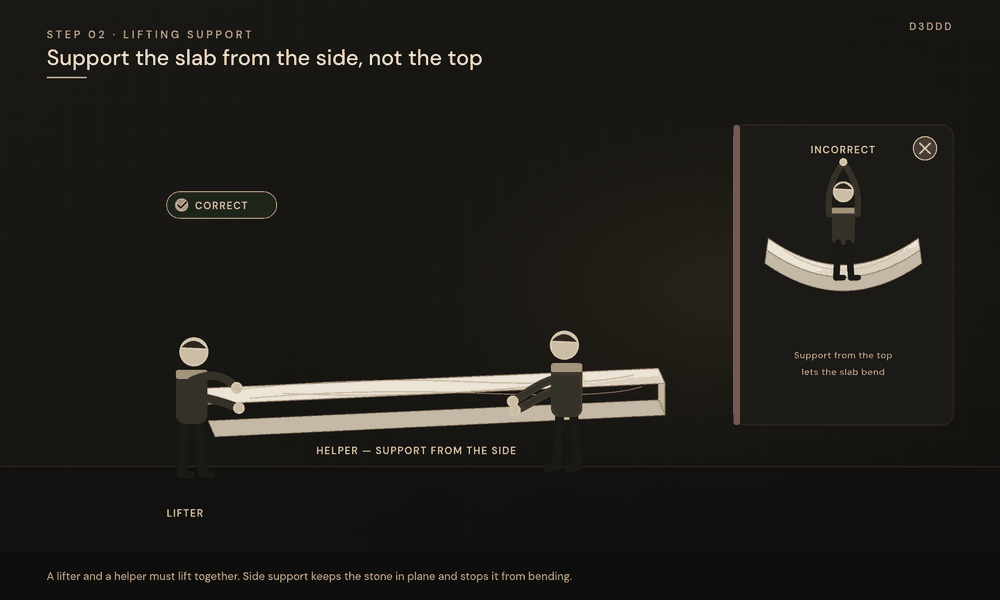
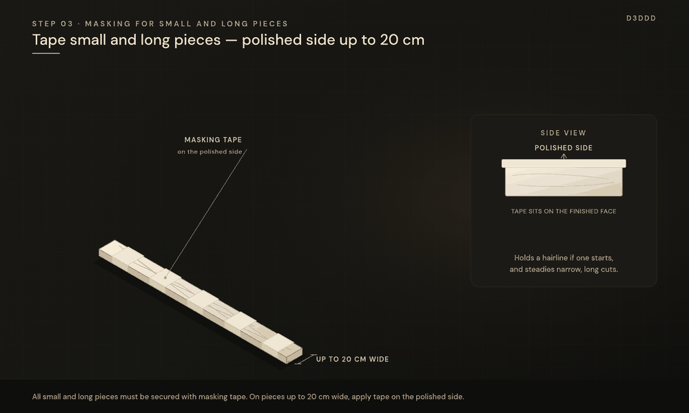
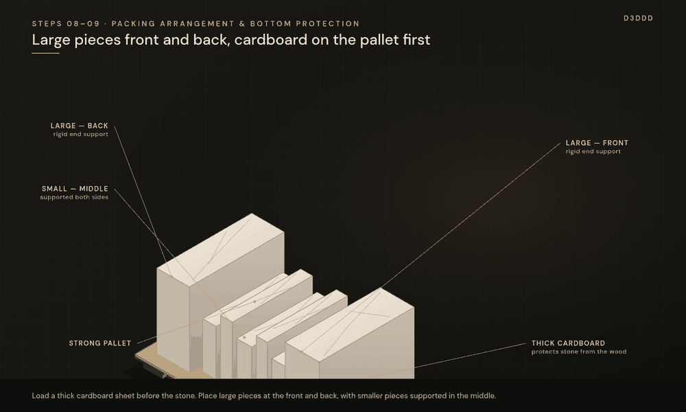
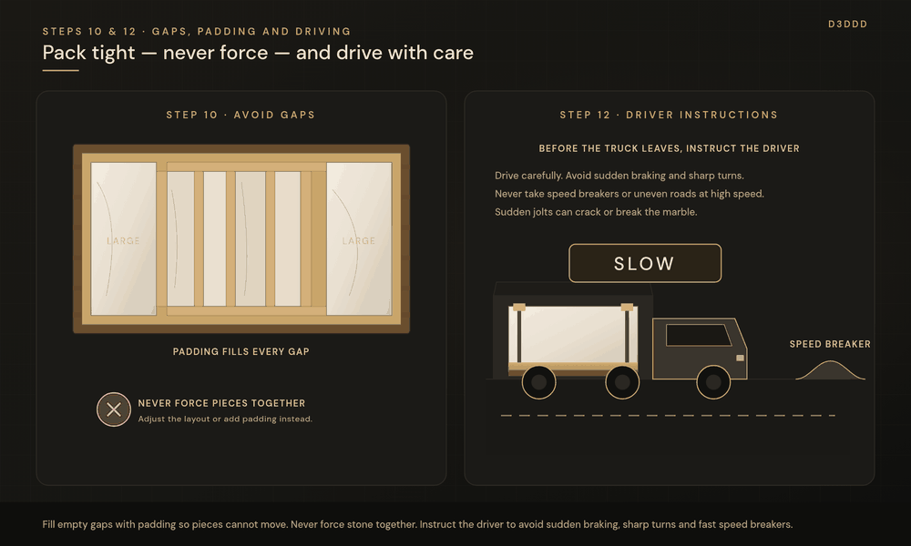
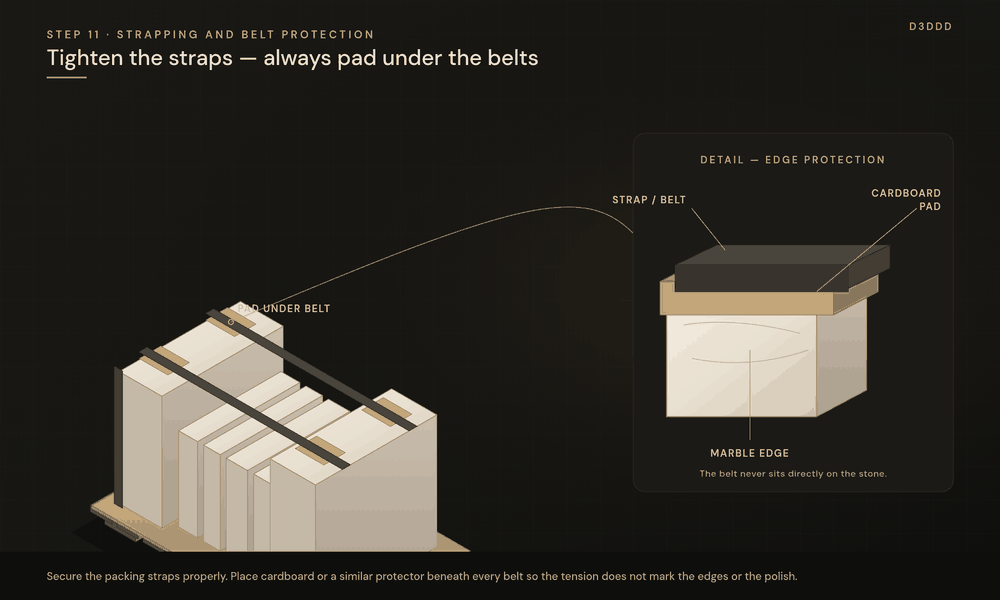
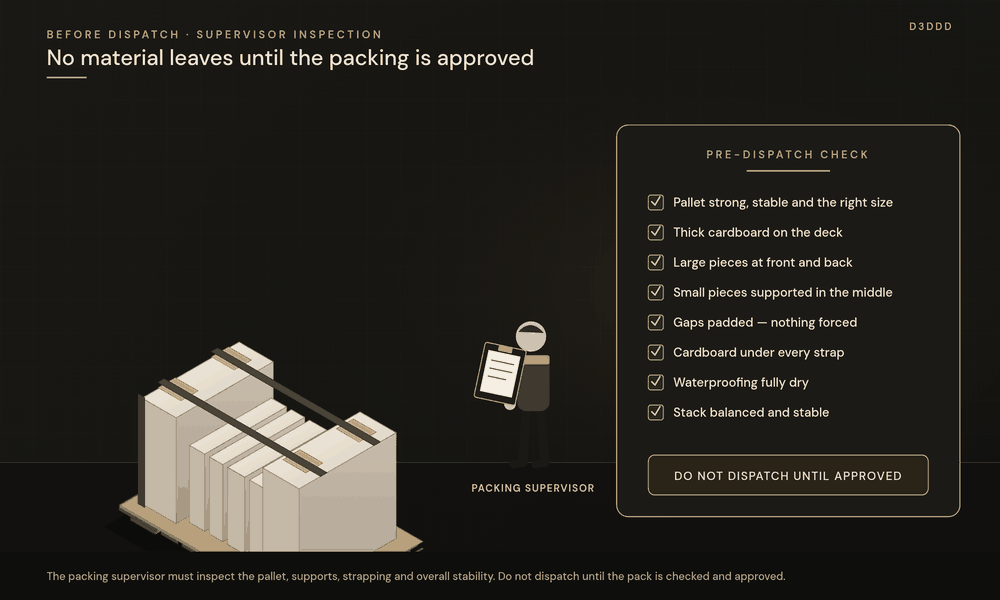

A marble piece can be cut to size, matched for vein and finished to a high polish, then still arrive cracked if it is lifted, packed or transported the wrong way. Breakage usually starts as a small bend, a gap in the pallet, or a jolt on the road — and by the time the crate is opened, the damage is already done.

This guide sets out the factory and packing instructions that teams should follow so stone leaves the workshop intact. It is written for factory and packing teams, packing supervisors, and contractors who need a clear standard before marble is dispatched.

All factory and packing teams must strictly follow the instructions below to prevent marble breakage during handling, packing and transportation.

## 1. Handling after cutting

Handle all cut pieces carefully after removing them from the cutting machine. Do not lift or move pieces roughly.

A piece is at its most vulnerable in the moments after it comes off the saw. The edges are fresh, the piece may still be wet, and there is often no tape or support on it yet. A rough lift, a twist, or setting it down on a hard corner can start a crack that is easy to miss on the bench and only opens later, during packing or transit. Move each piece with a planned grip, a clear path, and a prepared resting surface.

## 2. Lifting support

A lifter and a helper must always be present during lifting. The helper must support the slab from the side, not from the top, to prevent bending and breakage.

Marble is heavy and relatively stiff, but it does not like to be bent. If one person lifts from the ends or from the top edge only, the middle of the slab can sag under its own weight. That sag is what snaps a slab or opens a hairline.

Two people should lift together. The lifter takes the main load. The helper stands to the side and supports the slab along its face or long edge, keeping the stone in plane so it cannot bow. Do not hold the slab from the top alone, and do not try to walk a large piece with one person.

## 3. Masking for small and long pieces

All small and long pieces must be secured with masking tape. Pieces up to 20 cm wide must have masking tape applied on the polished side for additional support.

Narrow strips, long skirting, borders and slim risers flex more than a wide slab. A small twist during handling is enough to snap them. Masking tape around or along the piece holds the stone together if a crack starts, and it gives the packer a more stable item to move.

For pieces up to 20 cm wide, apply the tape on the polished side. The polished face is the tighter, more brittle surface; a continuous band of tape there acts as a temporary skin and helps stop a hairline from opening while the piece is lifted or stacked.

## 4. Dry lay inspection

After dry laying, carefully inspect every piece for hairline cracks, including large pieces. Apply masking tape over any visible hairline cracks to help prevent further opening during handling.

A dry lay is not only a check of colour, vein and fit. It is also the last clear look at every face before waterproofing and packing. Hairline cracks can appear in large slabs as well as in small cuts, and they are easy to overlook under workshop lighting if you only scan the small pieces.

Go over each piece slowly, including the back and the edges where a crack often starts. If you see a hairline, apply masking tape over it at once. The tape will not repair the stone, but it helps keep the crack from opening further while the piece is handled, coated and packed. Mark the piece so the packing supervisor can see it before dispatch.

## 5. Waterproofing

Mix the waterproofing material properly and apply it evenly. Clean any excess waterproofing material from the sides of the marble.

An uneven mix or a rushed coat leaves thick and thin patches. Thin areas do not protect the stone as intended. Thick or leftover material on the edges can smear onto the polished face, keep two pieces from sitting flush in the pallet, or stay tacky and stick to the packing. Mix the material as specified, apply it in an even coat, and wipe the sides clean before the coating starts to set.

## 6. Drying before packing

Do not pack the marble until the waterproofing has dried completely.

Wet or tacky waterproofing smears under pressure, sticks pieces to cardboard or to each other, and can trap moisture against the stone for the whole journey. Wait until the coat is fully dry to the touch and firm, then pack. If in doubt, give it more time rather than closing the pallet early.

## 7. Strong pallets

Always use strong, stable pallets suitable for the weight and size of the marble pieces.

The pallet is the structure that carries the full load from the packing bay to the site. A damaged, undersized or unstable pallet will flex, rack or collapse, and the bottom pieces take that movement first. Choose a pallet that matches the weight and the footprint of the stack, check that the deck and blocks are sound, and replace any pallet that feels soft, split or uneven before loading begins.

## 8. Packing arrangement

Arrange large pieces at the front and back, with smaller pieces placed in the middle, ensuring proper support and balance.

Large pieces form a rigid face at each end of the pallet. Smaller pieces sit between them, supported on both sides, so the stack stays balanced and does not lean. If small or narrow pieces are placed on the outside, they can shift, and the larger slabs may then tilt or lose support. Load the big pieces first as the front and back, fill the middle with the smaller ones, and check that the weight looks even before you add straps.

## 9. Bottom protection

Place thick cardboard on the wooden pallet before loading the marble to protect the bottom pieces from direct contact with the wood.

Wood is uneven. Deck boards, knots, nail heads and dirt will print onto the bottom pieces and can chip an edge or crack a corner once the full weight of the stack is on them, especially when the pallet vibrates in transit. A sheet of thick cardboard on the pallet first creates an even, slightly cushioned bed and keeps the stone off the wood.

## 10. Avoid gaps

Pack the pieces tightly with proper padding and support. Do not leave empty gaps that allow the marble to move during transportation. Never force pieces together.

A gap lets a piece slide when the vehicle brakes or turns. That movement becomes an impact, and impacts are what crack corners and open joints in the stack. Fill spaces with suitable padding so every piece is supported, and pack the stack so it is tight.

Tight does not mean forced. Never drive or hammer pieces together to close a gap. Forcing can chip an edge, crush a corner, or snap a narrow piece. If the arrangement does not close cleanly, adjust the layout or add padding — do not use pressure on the stone itself.

## 11. Strapping and belt protection

Secure the packing straps or belts properly. Always place cardboard or suitable protective material beneath the belts to prevent pressure damage to the marble edges and polished surfaces.

Straps keep the stack from shifting, but a tight belt sitting directly on marble will bite into the edge or leave a pressure mark on a polished face. Place cardboard or another suitable protector under every belt, especially at corners and on finished surfaces, then tighten the straps so the pallet is secure without crushing the stone. Check that the protectors have not slipped before you sign the pallet off.

## 12. Driver instructions

Instruct the driver to drive carefully, avoid sudden braking and sharp turns, and never drive over speed breakers or uneven roads at high speed. Sudden jolts can cause the marble to crack or break.

A well-packed pallet can still fail if the vehicle slams over a speed breaker or stops suddenly. The stack is heavy, and a jolt lifts and drops that weight in a fraction of a second. Before the truck leaves, tell the driver to:

- drive carefully
- avoid sudden braking and sharp turns
- never take speed breakers or uneven roads at high speed

This instruction is part of the packing job, not an afterthought at the gate.

## Pre-dispatch inspection

The packing supervisor must inspect the pallet, supports, strapping and overall stability before dispatch. No material should be dispatched until the packing is properly checked and approved.

The supervisor is the last line of defence. A walk-around should confirm that the pallet is sound, the arrangement is balanced, padding has closed the gaps, cardboard is under the straps, and the stack does not rock or lean. If anything is unfinished, loose or unclear, the pallet stays in the bay until it is corrected and approved. Do not dispatch on a verbal “it should be fine.”

## Pre-dispatch checklist

Print or copy this list and tick each item before the marble leaves the factory.

**Handling and preparation**

- [ ] Cut pieces were handled carefully after leaving the machine — no rough lifting or moving
- [ ] Every lift used a lifter and a helper, with side support, not support from the top
- [ ] All small and long pieces are secured with masking tape
- [ ] Pieces up to 20 cm wide have masking tape on the polished side
- [ ] After the dry lay, every piece was inspected for hairline cracks, including large pieces
- [ ] Visible hairline cracks are taped and marked

**Waterproofing**

- [ ] Waterproofing was mixed properly and applied evenly
- [ ] Excess waterproofing was cleaned from the sides
- [ ] Waterproofing is completely dry before packing

**Pallet and packing**

- [ ] Pallet is strong, stable and suitable for the weight and size of the pieces
- [ ] Thick cardboard is on the wooden pallet, under the marble
- [ ] Large pieces are at the front and back; smaller pieces are in the middle, with proper support and balance
- [ ] Pieces are packed tightly with padding; there are no empty gaps
- [ ] No pieces were forced together
- [ ] Straps or belts are secure
- [ ] Cardboard or other protection is under every belt, at edges and polished surfaces

**Dispatch**

- [ ] The driver has been instructed to drive carefully, avoid sudden braking and sharp turns, and not take speed breakers or uneven roads at high speed
- [ ] Packing supervisor has inspected the pallet, supports, strapping and overall stability
- [ ] Packing is approved — no material leaves without this approval

## Frequently Asked Questions

### Why must the helper support the slab from the side, not from the top?

Support from the top lets the slab sag under its own weight. Side support keeps the stone in plane and reduces the bending that causes breakage. A lifter and a helper should always lift together.

### Should every hairline crack be taped, even on large pieces?

Yes. After the dry lay, inspect every piece, including large slabs, and apply masking tape over any visible hairline crack so it is less likely to open during later handling.

### Can we pack marble before the waterproofing has dried?

No. Pack only when the waterproofing has dried completely. A coat that is still wet or tacky can smear, stick to the packing, and trap moisture against the stone.

### Who approves the pallet for dispatch?

The packing supervisor. The pallet, supports, strapping and overall stability must be inspected, and no material should leave until that packing is checked and approved.

## Follow the full sequence, then get the drawings right

Careful handling, side support, timely masking, a complete dry-lay check, even waterproofing, a strong pallet, a balanced pack and a cautious driver all work together. Leave one of them out, and a finished piece can still break on the way to site.

If you need marble shop drawings, cutting lists or fabrication drawings prepared before the stone is cut and packed, D3DDD (Dubai 3D Design & Draft) can help. See the [Marble Shop Drawings service page](/marble.html), or read more on [marble shop drawings vs fabrication drawings](/blog/marble-shop-drawings-vs-fabrication-drawings/) and [slab nesting and cutting lists](/blog/slab-nesting-cutting-lists-gulf/).

**[Request a quote](/contact.html)** or write to [info@d3ddd.com](mailto:info@d3ddd.com).
