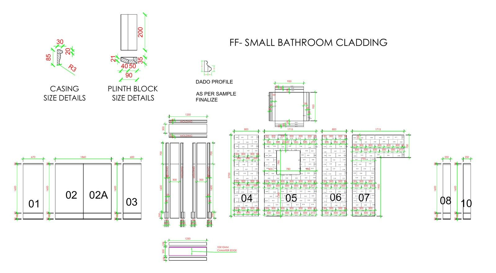
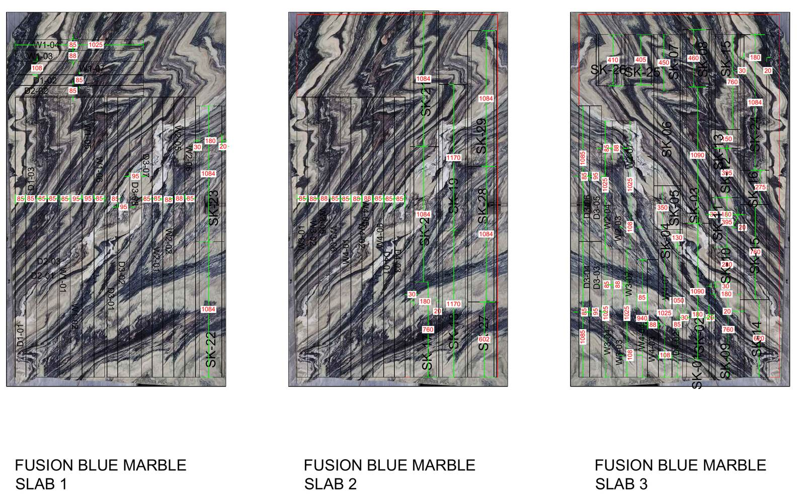

*By Shoaib Hussan, Founder of D3DDD*

**To calculate marble quantities, measure the net area of every piece from the drawings, add an allowance for cuts and defects, then convert the total into slabs.** The allowance depends on the stone, the layout and the vein matching, so agree it with your fabricator instead of using a fixed number.

*Numbered wall panels 01 to 10 with casing, plinth and dado profiles from the Venatino bathroom cutting set. See the [marble slab cutting layout](https://d3ddd.com/projects/marble-slab-cutting-layout-bathroom-cladding/).*

*Three Fusion Blue slabs with door-frame and skirting pieces nested along the vein. See the [Fusion Blue door frame slab layout](https://d3ddd.com/projects/fusion-blue-marble-door-frame-and-skirting-slab-layout/).*

## What is a marble quantity takeoff?

A takeoff is a list of every marble piece in a project with its size, thickness, finish and location, totalled by area and by type. It is the base for the BOQ (bill of quantities) and for the stone order.

## How do you calculate it, step by step?

1. **Start from approved drawings.** Use the latest shop or fabrication drawings, not the architect's concept layout.
2. **List every piece.** Floors, wall cladding, skirting, thresholds, vanity tops, steps and returns each get their own line.
3. **Calculate net area.** Length times width for each piece, minus cut-outs only if the offcut is not reusable.
4. **Group by material and thickness.** 20 mm and 30 mm stone are ordered separately.
5. **Add wastage.** Allow for saw kerf, trimming, defects and offcuts too small to reuse. Straight rectangular layouts waste less than diagonal, patterned or book-matched layouts.
6. **Convert to slabs.** Divide the gross area by the usable area of one slab, then round up. Check with a slab layout, since pieces rarely fill a slab perfectly.

## How can you reduce waste?

- Plan the cutting layout on the slab before ordering, so the order matches what is actually needed.
- Use offcuts from large pieces for skirting, thresholds and small returns.
- Keep visible areas first; fill hidden or small pieces into the gaps.
- Update the takeoff whenever the drawings change.

## Common mistakes

1. Ordering from gross room area instead of a piece list.
2. Using one wastage figure for every layout.
3. Forgetting skirting, thresholds and returns.
4. Ignoring thickness differences.

## FAQ

### How much extra marble should I order?
There is no single correct figure. It depends on layout complexity, vein matching and slab size, so confirm the allowance with your fabricator.

### What is the difference between a takeoff and a BOQ?
A takeoff measures quantities from drawings. A BOQ organises those quantities into priced or unpriced line items.

### Can quantities be calculated remotely?
Yes, from digital drawings or plans.

### How much do marble drawings cost?
A D3DDD shop drawing pack is AED 1,200, with 50% paid upfront. Estimation scopes are quoted individually.

## Get your marble quantities checked by D3DDD

D3DDD (Dubai 3D Design & Draft) prepares the drawings described in the [Marble Shop Drawings Guide (UAE)](/blog/what-are-marble-shop-drawings/) and quantity takeoffs for UAE contractors, fabricators and designers. See our [BOQ and estimation service](https://d3ddd.com/services/architectural-estimation/), the [Marble Shop Drawings service page](https://d3ddd.com/marble.html), and related posts on [slab allocation and cutting optimization](https://d3ddd.com/blog/marble-slab-allocation-cutting-optimization/) and [slab nesting and cutting lists](https://d3ddd.com/blog/slab-nesting-cutting-lists-gulf/).

**[Request a quote](https://d3ddd.com/contact).**
