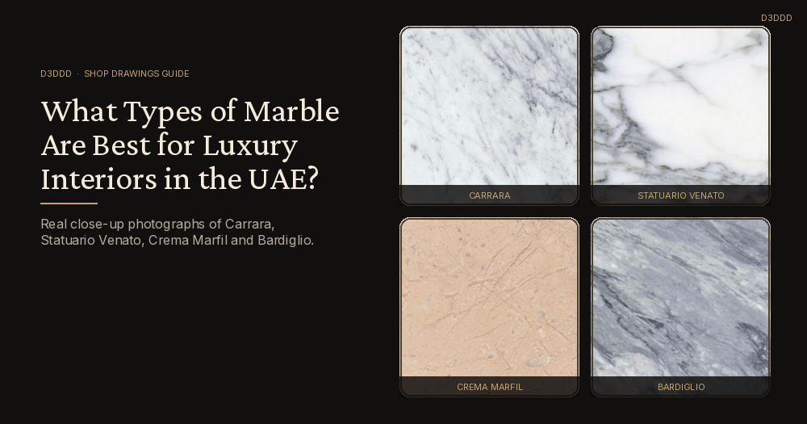
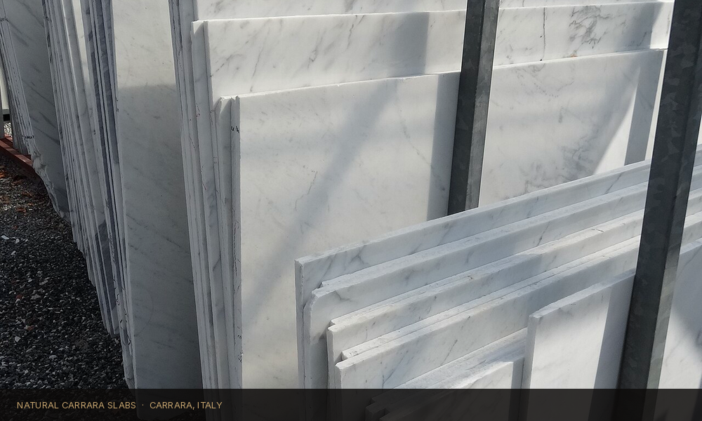
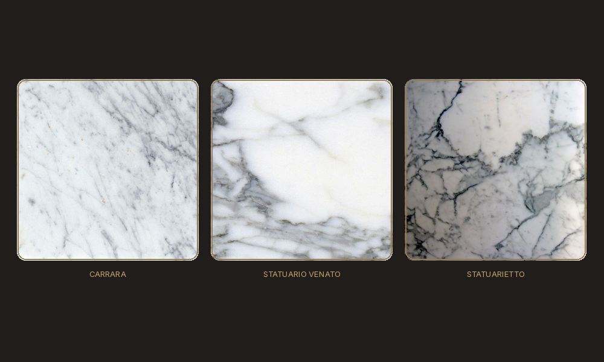
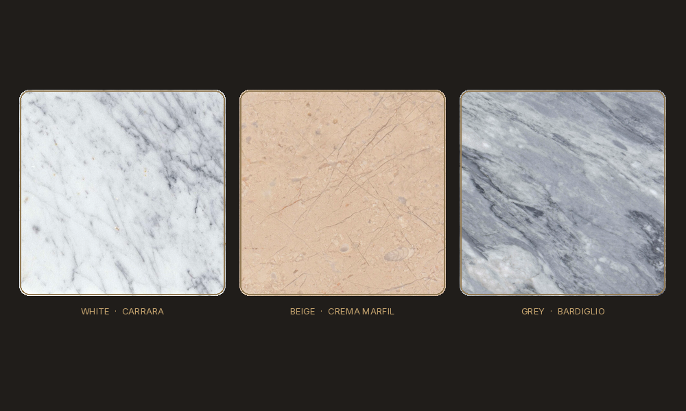
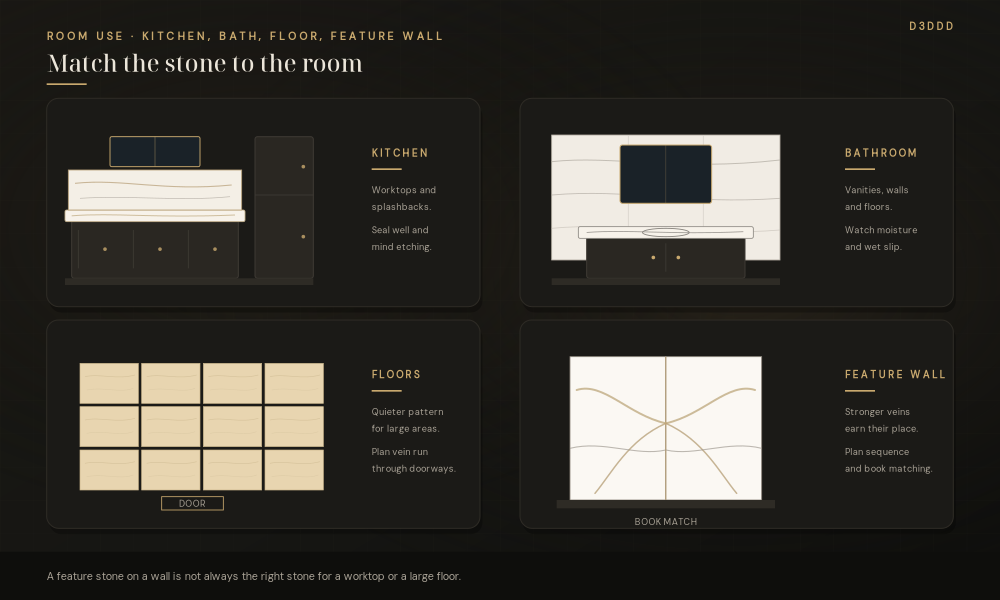

*By Shoaib Hussan, Founder of D3DDD*

The right marble for a UAE interior is not only a question of taste. It is also a question of light, use, maintenance, and how the stone will be cut and joined. A white Italian slab that looks calm on a small sample can dominate a sunlit living room. A dark floor that looks rich in a showroom can feel hot and dusty beside a full-height window.

This article explains the difference between natural marble and engineered or cultured marble, then looks at the natural types most often specified in luxury homes and projects in the UAE. It also covers how colour families change a room, which stones tend to suit which surfaces, and why shop drawings, slab allocation and edge details still matter after the material is chosen.

D3DDD prepares marble shop drawings and visualisation. We do not sell or stock slabs.

## Natural marble or engineered stone — which should you specify?

### Natural marble

Natural marble is a quarried metamorphic stone, formed from limestone that has been recrystallised under heat and pressure. Each block has its own ground colour, vein movement and faults. That variation is the reason designers like it, and the reason neighbouring pieces must be planned from the same slabs if the finished surface is to look continuous.

Because marble is largely calcium carbonate, it is porous and can etch when acids such as lemon, vinegar or some cleaners sit on the face. A sealer helps reduce staining, but it does not make the stone stain-proof or etch-proof. A polished face shows a sharp reflection and makes colour and vein read clearly. A honed face is softer and can hide light wear, though it may mark in other ways.

Natural marble suits feature walls, floors, stairs, vanities and worktops where the unique pattern is part of the design, and where the client accepts routine sealing and careful cleaning.

### Engineered and cultured marble

Engineered and cultured marble are factory-made products that use marble dust or chips bound with resin. Cultured marble is typically moulded — often with a gel-coat face — into vanities, shower surrounds and similar fittings. Engineered or agglomerated marble is usually produced as slabs, with a more even colour and pattern than a natural block.

The main advantages are consistency and, in many products, a less porous face that is easier to keep clean. The look is more uniform, which can be useful in a long run of vanities or a tight colour scheme. The trade-off is character: the surface will not have the same one-off movement as a natural slab, and repairs, heat response and ageing follow the resin system, not a quarry block.

Choose engineered or cultured marble when a consistent colour, a moulded shape, or easier day-to-day cleaning matters more than unique veining. Choose natural marble when the pattern itself is the point of the room.

## Natural types often used in luxury UAE interiors

The names below come up regularly in villas, apartments and hospitality interiors. Availability, grade and exact colour shift from batch to batch, so always approve the actual slabs, not only a name in a specification.

### Carrara

Carrara, from the Carrara area of Italy, has a white to soft grey ground with relatively fine, feathery grey veins. It is one of the more familiar Italian whites and tends to feel quieter than Calacatta or Statuario. It works well on floors, bathrooms and larger wall areas where a bright stone is wanted without a very strong pattern.

### Calacatta

Calacatta, also from Italy, is usually a brighter white with bolder, more theatrical veins that can run grey, gold or both. It is often reserved for surfaces that are seen head-on: an island, a feature wall, a feature floor panel. Because the movement is strong, slab allocation and vein direction matter more than they do with a quieter stone.

### Statuario

Statuario is a bright white Italian marble with pronounced grey veining. Historically it was favoured for sculpture; in interiors it is used where a crisp white ground and a clear, graphic vein are required. Like Calacatta, it is typically a feature stone rather than a background one, and consecutive slabs should be selected and laid out together. A related commercial name is Statuarietto, a slightly quieter member of the same family. The third close-up in the photograph above is Statuarietto photographed in use, not a Calacatta slab.

### Emperador

Emperador, typically from Spain, is a brown marble with a lighter web of veins. Darker and lighter varieties are both used. It brings warmth that white stones cannot, and it sits comfortably in studies, dining rooms, stairs and more traditional rooms, as well as in contemporary schemes that need a darker contrast.

### Crema Marfil

Crema Marfil, from Spain, is a cream to beige marble with soft, cloudy movement rather than sharp graphic veins. It is widely used in the region because it feels warm, sits well with timber and brass, and does not glare in strong daylight the way a very bright white sometimes can. It is a practical choice for large floors, stairs, wall cladding and more classical interiors.

### Verde Guatemala

Verde Guatemala is a green marble with white and darker green movement. In luxury interiors it is usually an accent — a powder-room wall, a table, a fireplace, a framed panel — rather than a whole-floor stone. Used with restraint, it gives a room a colour that beige and grey palettes cannot.

### Nero Marquina and grey options

Two further stones are useful when a scheme needs contrast or a cooler palette. Nero Marquina, from Spain, is a deep black marble with distinctive white veins. It is dramatic on feature walls, reception desks and bathroom walls, but on floors it will show dust and watermarks, and in direct sun a dark floor can feel warm underfoot.

For grey, designers in the UAE often look at Pietra Grey, a consistent grey limestone with fine white lines, or at Bardiglio, a grey marble from the Carrara district. Pietra Grey is technically a limestone, not a marble, but it is specified alongside marble in many contemporary projects because the colour is even and the look is modern. Grey stones sit well with white walls, dark metal and large glazing.

## How colour families affect a room in the UAE

UAE interiors often combine large windows, bright daylight and a mix of contemporary and traditional rooms in the same home. Colour should be chosen with that in mind, not only from a sample held in a showroom.

**White** reflects light and can make a room feel larger and cooler. In a sunlit villa it can also feel very bright, so a stone with some vein or a slightly grey ground, such as Carrara, is often easier to live with than a stark, barely marked white. White floors and walls show the quality of the joints and the consistency of the slabs, so layout and allocation need care.

**Black** gives contrast and a modern edge. It works as a border, a vanity, a feature wall or a table more readily than as a large sunlit floor, where dust, water spots and heat are more noticeable.

**Beige and cream** are forgiving in strong light and sit naturally with both a formal majlis and a quieter living room. They hide everyday dust better than black, and they connect easily to sand-coloured exteriors and warm metals.

**Grey** is the usual bridge between a white contemporary interior and darker furniture or metalwork. It reads as current without the maintenance demands of a black floor.

**Green** is best treated as a feature colour. A little goes a long way, especially under the strong light typical of UAE rooms.

Mixing families in one home is common and often successful: a cream floor with a white bathroom, or a grey living area with a darker stone on a stair or fireplace. The join between two stones should be drawn, not left to site.

## Which marble for which room?

**Kitchens.** Worktops see oil, spice, citrus and regular cleaning. Natural marble can be used, but it needs sealing and a gentle, pH-neutral cleaner; acidic food and harsh products can etch a polished face. Honed finishes tend to show etching less than a high polish, though they can mark in other ways. If the client wants a very uniform, low-maintenance top, engineered stone may be the more practical choice, with natural marble reserved for a splashback or island face where the pattern is on display.

**Bathrooms.** Vanities, walls and floors all work in marble when the stone is sealed and the wet-area details are correct. Polished floors can be slippery when wet; a honed finish, a suitable texture, or keeping polish to the walls and vanity is often more comfortable. Steam and standing water make a sound specification and a clear set of drawings as important as the stone name.

**Floors and living areas.** Large floor areas favour stones with quieter movement — Carrara, Crema Marfil, an even grey — so the room does not become busy. Strongly veined stones can be used in panels or as a border. Think about slip resistance, slab size, and how the vein will run through doorways and into adjacent rooms.

**Feature walls.** This is where Calacatta, Statuario, Nero Marquina or Verde Guatemala usually earn their place. Book matching and slab sequence should be planned before the stone is cut, otherwise the wall will not read as one surface.

## Maintenance and durability, in brief

Marble is not a “fit and forget” surface. How it wears depends on porosity, finish and use, not only on the type name.

- Seal natural marble as recommended for the stone and the location, and reseal when water no longer beads on the face.
- Use pH-neutral cleaners. Avoid acids, bleach and abrasive powders on the finished face.
- Wipe spills — especially oil, coffee, wine and acidic food — rather than leaving them to sit.
- A polished finish is glossier and shows the vein clearly; it also shows etching and fine scratches more readily. A honed finish is muted and can be more forgiving of light wear, but it may stain more visibly if left unsealed.
- Tight veins, filled fissures and honed or polished edges should be agreed on the drawings so the workshop and the site team are working to the same standard.

No stone type is maintenance-free in a kitchen or a family bathroom. The honest choice is the one whose look the client wants and whose care they will actually keep up.

## Choosing the stone is only half the job

A sample or a slab photo decides the look. The finished room depends on how those slabs are allocated, how the pieces are numbered and cut, and how the edges, joints and corners are detailed.

[Shop drawings](https://d3ddd.com/blog/marble-shop-drawings-vs-fabrication-drawings/) show how the stone sits in the space so the design can be approved. Fabrication drawings and cutting lists tell the workshop the size, edge and finish of each piece. [Slab allocation](https://d3ddd.com/blog/marble-slab-allocation-cutting-optimization/) assigns pieces to particular slabs so the vein and colour continue across a wall or a floor. [Edge profiles](https://d3ddd.com/blog/marble-edge-profiles-uae-projects/) — eased, chamfer, bullnose, ogee or mitered — change both the look and the way a countertop or stair is made.

D3DDD (Dubai 3D Design & Draft) prepares this drawing and visualisation work for contractors, fabricators, designers and homeowners in the UAE. We do not supply marble. A shop drawing pack is AED 1,200, with 50% paid upfront. Larger scopes are quoted individually.

See the [Marble Shop Drawings service page](https://d3ddd.com/marble.html), and the related guides to [shop drawings versus fabrication drawings](https://d3ddd.com/blog/marble-shop-drawings-vs-fabrication-drawings/), [slab allocation and cutting optimization](https://d3ddd.com/blog/marble-slab-allocation-cutting-optimization/) and [marble edge profiles used in UAE projects](https://d3ddd.com/blog/marble-edge-profiles-uae-projects/).

## Frequently Asked Questions

### Is natural marble practical in a UAE kitchen?

It can be, if the client accepts sealing, prompt cleaning of spills and the chance of etching on a polished face. For a worktop that must stay very uniform and easy to wipe, an engineered surface may be the better workhorse, with natural marble used where the pattern is meant to be seen.

### How do I choose between Carrara, Calacatta and Statuario?

Start with the amount of pattern you want and the role of the surface. Carrara is usually the quieter of the three and can cover larger areas. Calacatta and Statuario have a brighter ground and a stronger vein, and they are typically used as feature stones. Always select from the actual slabs.

### Should the marble be honed or polished?

Polish gives depth and a clear reflection; honed gives a softer, matte look and can hide light etching better. In wet floors, polish can be slippery. Match the finish to the room, and show it on the drawings so every exposed edge matches the face.

### Does D3DDD supply marble?

No. D3DDD prepares shop drawings, fabrication drawings, slab layouts and visualisation. Stone supply is separate, and should be coordinated with your fabricator or supplier.

## Photo credits

The close-up photographs on this page are used under the licences named below. Scale bars on the original sample photos were cropped.

- Carrara: [Carrara marble CD](https://commons.wikimedia.org/wiki/File:Carrara_marble_CD.jpg) by Lysippos, [CC BY-SA 4.0](https://creativecommons.org/licenses/by-sa/4.0/).
- Statuario Venato: [Carrara Sta-ven](https://commons.wikimedia.org/wiki/File:Carrara_Sta-ven.JPG) by Lysippos, [CC BY-SA 3.0](https://creativecommons.org/licenses/by-sa/3.0/).
- Statuarietto: [Statuarietto White Marble (Carrara region, Italy)](https://commons.wikimedia.org/wiki/File:Statuarietto_White_Marble_(Apuan_Marble_Formation,_Tertiary_metamorphism_of_Jurassic_limestones;_Carrara_region,_Italy)_2_(41756462202).jpg) by James St. John, [CC BY 2.0](https://creativecommons.org/licenses/by/2.0/).
- Crema Marfil: [Limestone Crema Marfil](https://commons.wikimedia.org/wiki/File:Limestone_Crema_Marfil_-_es.jpg) by Lysippos, [CC BY-SA 4.0](https://creativecommons.org/licenses/by-sa/4.0/).
- Bardiglio: [BARDIGLIO](https://commons.wikimedia.org/wiki/File:BARDIGLIO.jpg) by Rolle-Stone, public domain.
- Natural Carrara slabs: [2016 - Carrara stone samples](https://commons.wikimedia.org/wiki/File:2016_-_Carrara_stone_samples.jpg) by Jordiferrer, [CC BY-SA 4.0](https://creativecommons.org/licenses/by-sa/4.0/).

## Get the stone choice onto drawings

The type and colour of marble set the character of a luxury interior. The quality of the finished work depends on approving real slabs, planning how they are cut and joined, and showing edges and finishes clearly before anyone goes to the saw.

If you already have a stone in mind, or you need help turning a design into a cutting set, D3DDD can prepare the drawings.

**[Request a quote for your marble drawings](https://d3ddd.com/contact)** or write to [info@d3ddd.com](mailto:info@d3ddd.com).
