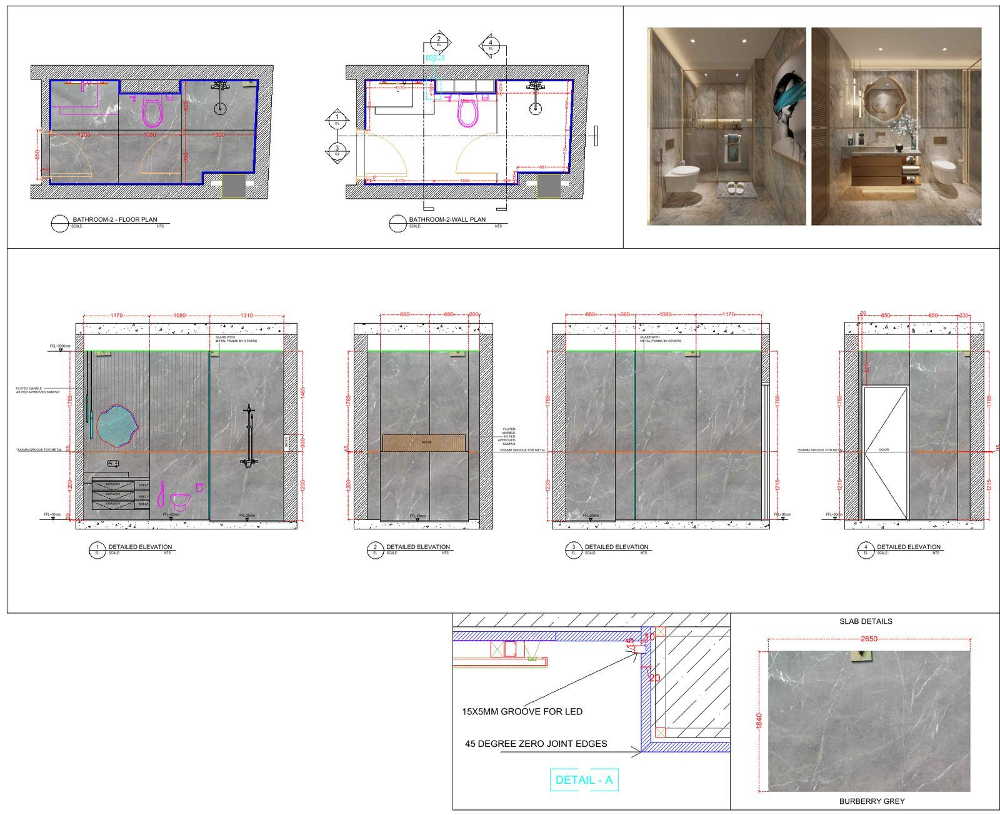
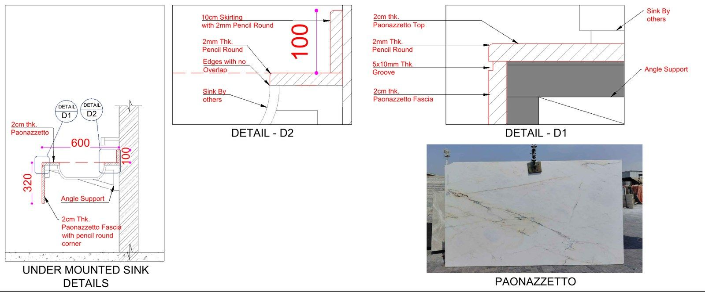

Marble is expensive and heavy, and once a slab is cut it can't be uncut. That is why most UAE fit-out and construction projects won't let stone go into fabrication until **marble shop drawings** have been prepared, reviewed and approved. This guide covers what marble shop drawings are, what goes into them, who uses them, and why they matter on projects in Dubai and across the UAE.

## What Are Marble Shop Drawings?

Marble shop drawings are detailed technical drawings that show exactly how marble or natural stone will be laid out, cut, finished and installed on a specific project. They are usually prepared by the contractor or the stone subcontractor, or by a drafting specialist working for them. They are based on the architect's or interior designer's design drawings.

Design drawings show the *intent*: a marble floor in the lobby, a stone-clad feature wall, a vanity top in a master bathroom. Shop drawings show the *execution*: the size and position of every piece, the joint widths, the edge profiles, the fixing method and how the stone meets other materials.

In practice, marble shop drawings are prepared in AutoCAD and issued as PDF and DWG files for review.

## What Do Marble Shop Drawings Include?

The exact contents depend on the scope and the consultant's requirements, but a complete set usually covers the following.

### Layout plans

- Floor layouts showing the size, direction and position of each tile or slab
- The setting-out point and where the pattern starts
- Joint widths and movement or expansion joint locations
- Borders, inlays and feature patterns

### Wall cladding elevations

- Elevations showing every cladding panel, with its size and joint lines
- Openings, niches, sockets and switches cut into the stone
- Panel numbering that ties back to the cutting list

<figure class="prose-fig"><figcaption class="img-credit">Floor plan, wall plan and dimensioned cladding elevations for a villa bathroom in Dubai. From our project <a href="/projects/luxury-bathroom-marble-cladding-shop-drawings/">Luxury Bathroom Marble Cladding Shop Drawings</a>.</figcaption></figure>

### Sections and details

- Sections through floors, walls, steps and countertops
- Edge profiles, such as bullnose, chamfer, eased or mitred edges
- Interfaces with skirting, thresholds, glass, joinery and sanitary fittings
- Fixing details for wall cladding, such as adhesive fixing or mechanical anchors, as specified

<figure class="prose-fig"><figcaption class="img-credit">Section and edge details for Paonazzetto vanity tops: sink junction, pencil-round edges, drip groove and support bracket. From our project <a href="/projects/paonazzetto-marble-vanity-tops-shop-drawings/">Paonazzetto Marble Vanity Tops Shop Drawings</a>.</figcaption></figure>

### Material and finish information

- Stone type, thickness and surface finish (polished, honed, leathered and so on)
- Areas where vein direction, book matching or colour consistency matter
- Notes on sealing and treatment where the specification requires them

### Piece schedules and cutting lists

- A numbered schedule of every piece with its dimensions
- Cutting lists the fabrication workshop can follow
- Quantities that support the order and the BOQ

For a deeper checklist aimed at fabricators, see our earlier post: [Marble Shop Drawings in the UAE: A Practical Checklist for Fabricators](/blog/marble-shop-drawings-checklist-uae/).

## Why Are Marble Shop Drawings Necessary?

### 1. Consultant approval before fabrication

On most UAE projects, the consultant or engineer has to review and approve shop drawings before fabrication starts. Submitting clear, coordinated marble shop drawings is part of the normal approval process. Drawings that are vague or don't match the design are usually returned for revision, and that delays the programme.

### 2. Stone can't be fixed after cutting

A cutting error in marble often means the piece is wasted and new material has to be sourced, sometimes from the same quarry block to keep the colour and veining consistent. Shop drawings settle every dimension, cut-out and edge *on paper* before the saw touches the slab.

### 3. Better slab use and less waste

When every piece is drawn and numbered, the fabricator can plan how pieces sit on each slab. That helps with vein matching, keeps the colour consistent across a room, and cuts down on offcuts. We cover this in more detail in [Slab Nesting and Cutting Lists: How Gulf Stone Yards Cut Waste](/blog/slab-nesting-cutting-lists-gulf/).

### 4. Coordination with other trades

Marble meets plenty of other trades: MEP outlets, drainage, joinery, glass, metal trims and false ceilings. Shop drawings show where those meet, so clashes come out during review instead of during installation.

### 5. Accurate quantities and costing

Drawings with piece-by-piece dimensions give a reliable base for quantity takeoffs and the stone BOQ. That helps contractors order the right amount of material and price the work properly. If you need quantities as well as drawings, see our [architectural estimation service](/services/architectural-estimation/).

### 6. A clear reference on site

On site, the installation team uses the approved shop drawings and piece numbers to put each piece in the right place. That reduces guesswork, especially on large floors, feature walls and staircases.

## Who Uses Marble Shop Drawings?

- **Contractors and fit-out companies:** to get approval, plan the work and coordinate trades
- **Stone fabricators and marble workshops:** to cut, finish and number each piece
- **Consultants and engineers:** to check the work against the design and specification
- **Architects and interior designers:** to confirm their design intent is carried through
- **Developers and homeowners:** to see exactly what they are getting before material is cut

## Where Are Marble Shop Drawings Used?

Typical applications in UAE projects include:

- Marble and stone flooring in lobbies, villas, apartments and retail spaces
- Interior and exterior wall cladding
- Bathroom vanities, countertops and kitchen tops
- Staircases, with tread, riser and landing details (see [Stone Staircase Shop Drawings: Treads, Risers, Stringers & Fixings](/blog/stone-staircase-shop-drawings-treads-risers/))
- Thresholds, skirting, window sills and feature elements

## What Is Needed to Start Marble Shop Drawings?

Before work can start, the drafter usually needs:

1. The approved architectural or interior design drawings (DWG preferred, PDF accepted)
2. The material specification: stone type, thickness and finish
3. Site measurements, or confirmation that the drawings match site conditions
4. Any consultant comments or specific submission requirements
5. Details of fixing systems and of the trades the stone meets

Checking the drawings against the actual site dimensions is important. Walls and floors on site are not always exactly as drawn, and stone needs to fit what is actually built.

## Frequently Asked Questions

### What is the difference between marble shop drawings and design drawings?

Design drawings from the architect or interior designer show the intended look and layout. Marble shop drawings turn that design into exact piece sizes, joints, edges, fixing details and cutting information that fabricators and installers can work from.

### Are marble shop drawings required in Dubai?

On most consultant-supervised projects in Dubai and the UAE, the contractor has to submit shop drawings for review and approval before fabrication. The exact requirement depends on the project's contract and the consultant.

### What is the difference between shop drawings and fabrication drawings?

Shop drawings are mainly for review and approval, showing how the work will be built and installed. Fabrication drawings, which include cutting lists and piece drawings, are prepared for the workshop to cut and finish each piece. On many marble projects the two are produced as part of the same package.

### What software is used for marble shop drawings?

AutoCAD is the most common, and drawings are usually shared as DWG and PDF files. Some projects also use 3D models to check complex areas or show clients the finished result.

### How much do marble shop drawings cost?

It depends on the size and complexity of the project. As a starting point, a D3DDD shop drawing pack is **AED 1,200**, with 50% paid upfront. For larger or more complex scopes, send your drawings for a tailored quote.

### Can marble shop drawings be prepared remotely?

Yes. If the design drawings, specifications and site measurements are available digitally, shop drawings can be prepared and revised remotely and sent for review by email.

## Get Marble Shop Drawings Prepared by D3DDD

D3DDD (Dubai 3D Design & Draft) prepares marble and stone shop drawings, cutting lists, fabrication drawings and BOQs for contractors, fabricators, consultants, designers and homeowners across the UAE. We also offer [architectural drafting](/services/architectural-drafting/) and [3D rendering and visualization](/services/3d-rendering-modeling-visualization/) if you need to show the finished stone before it is cut.

Learn more on our [Marble Shop Drawings service page](/marble.html).

**Ready to start? [Request a quote for your marble shop drawings](/contact.html).** Send your design drawings and scope, and we'll come back with a price and timeline. Shop drawing packs start at AED 1,200, with 50% upfront.

You can also see our work on Instagram at [@dubai3ddd](https://www.instagram.com/dubai3ddd/).
